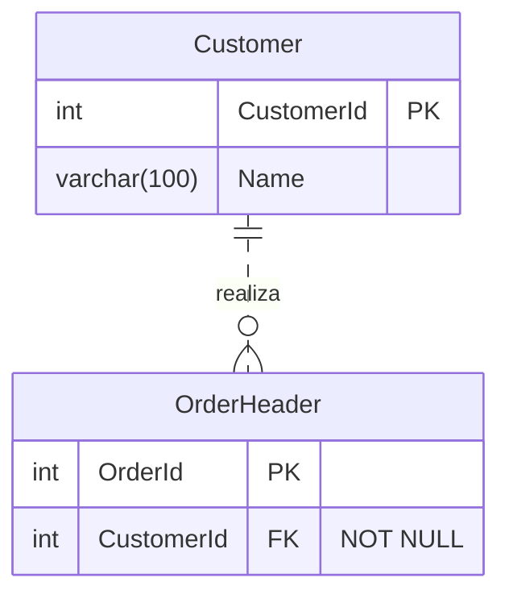

# Evaluación del modelo relacional

Adapta esta plantilla al alcance. Los campos vacíos solicitan información; no representan reglas aprobadas. Para cambios pequeños incluye solo las secciones útiles.

## Contexto y evidencia

- Objetivo y entorno:
- Motor, edición, CU y compatibilidad observados:
- Entidades, grano, límites de tenant/tiempo y fuente autoritativa:
- Requisitos confirmados y su procedencia:
- Preguntas pendientes y decisiones que dependen de ellas:

## Diccionario de datos

| Entidad / atributo | Significado / dominio | Tipo, longitud, precisión, escala / collation | NULL y motivo | PK / clave candidata / FK | DEFAULT / CHECK | Sensibilidad / histórico |
|---|---|---|---|---|---|---|

## Relaciones

| Padre y clave referenciada | Hijo y columnas FK | Hijos por padre: mínimo..máximo | Padres por hijo: mínimo..máximo | Unicidad / nulabilidad | ON DELETE / ON UPDATE | Regla y mecanismo de cumplimiento |
|---|---|---|---|---|---|---|

Distingue cardinalidad del negocio y restricciones realmente implementadas. Una FK no exige que todo padre tenga al menos un hijo. Un diagrama debe coincidir con estas tablas; no inventes cascadas por la apariencia de una relación.

## Diagrama opcional y ejemplo de uso

Entrada hipotética: «Cada pedido pertenece a un cliente; un cliente puede tener cero o varios pedidos. Cada pedido tiene un identificador independiente». Estas reglas solo están confirmadas para el ejemplo.

Salida gráfica correspondiente; `Customer` representa `sales.Customer` y `OrderHeader`, `sales.OrderHeader`:

Según la [sintaxis oficial Mermaid](../references/source-registry.md#mermaid), los extremos indican cardinalidad: `||` exactamente uno, `o|` cero o uno, `o{` cero o varios y `|{` uno o varios (orientados a la derecha). `--` expresa relación identificadora; `..`, no identificadora. La obligatoriedad y la identificación son conceptos distintos. PK/FK/UK son etiquetas; conserva en el diccionario las claves compuestas y constraints completas. Los tipos del diagrama no validan tipos SQL.

Adapta atributos y cardinalidades al caso confirmado. Si el visor no admite Mermaid, conserva el bloque y las tablas; no afirmes haberlo renderizado. Este ejemplo no prescribe cascadas ni demuestra normalización.

## Normalización

| Relación | Dependencias y estado de confirmación | Todas las claves candidatas / atributos primos | 1FN / 2FN / 3FN | Anomalías / contraejemplos | Propuesta |
|---|---|---|---|---|---|

- Demostración de reconstrucción sin pérdida:
- Demostración de preservación de dependencias:
- Restricciones adicionales y cómo se cumplen:
- BCNF / 4FN / 5FN, únicamente si existen dependencias relevantes confirmadas:
- Desnormalización: motivo, evidencia, autoridad y consistencia:

## Validación y transición

- Comprobaciones lógicas realizadas y conclusiones condicionadas:
- DDL propuesto y diferencias respecto del estado actual:
- Validación de datos, concurrencia y consumidores:
- Recursos, ventana, autorización, reversión y verificaciones posteriores:
- Pruebas ejecutadas realmente y pendientes:
